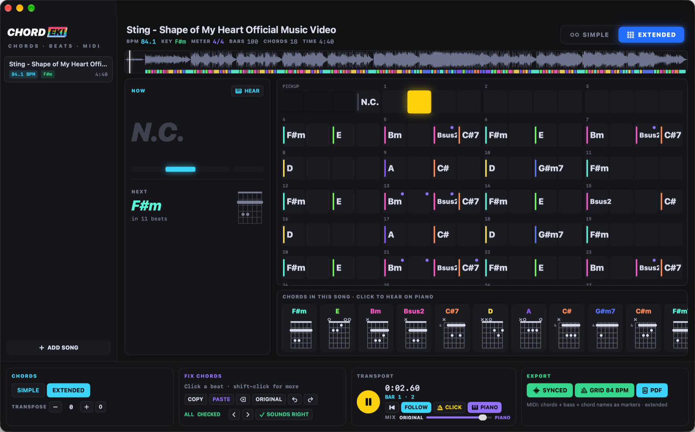

# CHORDEKI – chords · beats · midi

🇬🇧 English · [🇭🇺 Magyar](README.hu.md)

**▶ Website:** [ekidio.github.io/chordeki](https://ekidio.github.io/chordeki/) · **⬇ Download:** [latest release (DMG)](https://github.com/Ekidio/chordeki/releases/latest)



**CHORDEKI** listens to a song and writes down its chords on the beat grid, Chordify-style, then lets you check them by ear, fix them fast and take them anywhere as MIDI or a printable chord sheet.

It's a native macOS app (Swift, Apple Silicon). Analysis runs locally with a trained beat model (Beat This!) and librosa – your music never leaves your Mac.

CHORDEKI is an **EKIDIO SOUND** app. See also: [STEMEKI](https://github.com/Ekidio/stemeki) · [PADEKI](https://github.com/Ekidio/padeki).

## Features

- **Open any song:** MP3, WAV, AIFF, M4A, FLAC, WEBM (⌘O or drop on the window).
- **Beats and bars:** every beat and the 1 of the bar, tempo, meter and key.
- **Chords on the beat:** major / minor, or extended (7, maj7, m7, sus2, sus4, add9, dim, m7b5, aug). SIMPLE / EXTENDED switch, transpose.
- **Play along:** chord grid that follows the song, NOW / NEXT with guitar shapes, metronome CLICK on the detected beats.
- **Check by ear:** click any chord to hear it on the piano. **PIANO** plays the chords along with the song (MIX: original ↔ piano); with PIANO on, ← / → step from chord to chord.
- **Unsure chords:** the ones the engine wasn't sure of are marked; **U** goes to the next one, **O** marks it right.
- **Fix fast:** select beats (click, shift-click), pick a chord from the song's chords or any chord, ⌫ removes one (the chord before goes on), ⌘C / ⌘V copy a whole passage, ⌘Z undo.
- **Song sections:** INTRO, VERSE, CHORUS, BRIDGE, OUTRO… suggested by ear and editable (right-click → Section Starts Here); the grid starts every section on a new row, the waveform shows them in colour, and they go into the PDF and as cue markers into the MIDI.
- **Piano or guitar:** every chord on piano keys (the default) or as a guitar shape (PIANO / GUITAR) – and heard on that instrument: piano, or a strummed nylon-string acoustic guitar playing the shape shown. The PDF follows the choice.
- **Strike again:** a held chord can start again on any beat – a new note in the MIDI, no cutting in the DAW.
- **Build a chord on the piano:** none of the detected chords fits? Press **B** (or right-click → Build Chord on Piano…) and draw the chord note by note on a big keyboard: every click adds a note and you hear all the notes so far together; click a note again to take it out. CHORDEKI names it (Cmaj7, D/F#, F#m9…), and it plays – also in the MIDI – exactly as you built it.
- **Same music elsewhere:** CHORDEKI hears which bars are the same music; after a fix it offers to put it there too (**A**).
- **Roman or Nashville:** chord names as letters (ABC), or as degrees of the key – Roman (i, bVII, iv, V7) or Nashville (1m, b7, 4m, 5⁷) – in the grid, NOW / NEXT and the PDF.
- **MIDI in the song's rhythm:** with **RHYTHM** on, the MIDI chord track plays where the recording's accompaniment plays (16th grid, with its dynamics) instead of held chords.
- **Export:** MIDI **SYNCED** (tempo map follows the recording) or **GRID** (steady whole BPM), and a **PDF chord sheet** (⌘P).
- Updates itself (Sparkle).

## Keys

| Key | |
|---|---|
| Space | play / pause |
| ← / → | a bar back / forward (with PIANO on: chord by chord) |
| Enter | to the start |
| P | hear the chord on the piano |
| B | build a chord on the piano for the selection |
| J / K | PIANO / CLICK on-off |
| U / ⇧U | next / previous unsure chord |
| O | the chord sounds right |
| A | apply the fix to the same music elsewhere |
| ⌫ | remove the chord |
| ⌘C / ⌘V / ⌘Z | copy / paste / undo chords |
| ⌘E / ⇧⌘E | export MIDI synced / grid |
| ⌘P | export PDF chord sheet |

## Build

```sh
./build.sh --install     # builds dist/CHORDEKI.app and copies it to ~/Applications
./make-dmg.sh            # the installer DMG
./make-release.sh        # DMG + Sparkle appcast for a GitHub release
```

On first launch the app installs its analysis engine (Python, Beat This!, librosa) into `~/Library/Application Support/CHORDEKI/Engine` with one click.

## Credits

Beats: [Beat This!](https://github.com/CPJKU/beat_this) (JKU Linz, MIT). Audio analysis: [librosa](https://librosa.org). Updates: [Sparkle](https://sparkle-project.org).

© 2026 ekidio
